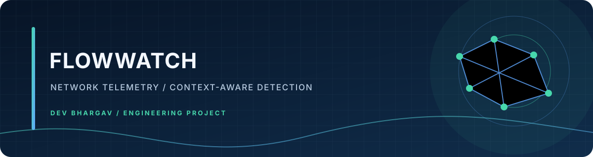

# FlowWatch

> **Self-hosted NetFlow observability and context-aware network anomaly detection.**



FlowWatch explores how raw network telemetry can become useful security intelligence by combining **traffic behaviour, device context, network roles, asset criticality, and risk scoring**.


## Why I Built It

While studying Cisco Secure Network Analytics / Stealthwatch, I wanted to understand the engineering problem behind turning large volumes of network flows into a small number of useful security signals.

FlowWatch is my practical exploration of that problem, starting with traffic-only detection and progressively adding context and risk.

## Detection Pipeline

```text
NetFlow
   │
   ▼
Collection
   │
   ▼
Traffic Features ──────┐
   │                   │
   ▼                   ▼
Traffic Detection   Context Enrichment
                       │
                       ├── Device identity
                       ├── VLAN / network role
                       ├── Destination familiarity
                       └── Asset criticality
                              │
                              ▼
                         Risk Scoring
                              │
                              ▼
                    Dashboard / REST API
```

## Detection Model

| Engine | Inputs | Purpose |
|---|---|---|
| **Traffic-Only** | Packets, bytes, duration, rate | Detect unusual traffic behaviour |
| **Context-Aware** | Traffic + device/network context | Detect behavioural and policy anomalies |
| **Risk-Informed** | Traffic + context + asset criticality | Prioritize findings with a 0-100 risk score |

## Current Capabilities

- NetFlow v5 collection
- Traffic anomaly detection
- Network-context enrichment
- Asset criticality and risk scoring
- Flow inspection
- Inventory-based context
- Dashboard and REST API
- Replay tooling for controlled lab testing
- Detection scenarios for normal traffic, DoS-like behaviour, and port scanning

## Quick Start

```bash
pip install -r requirements.txt
python3 backend/app.py
```

Open `http://127.0.0.1:5000`.

For controlled lab replay:

```bash
python3 tools/replay_generator.py --scenario normal
python3 tools/replay_generator.py --scenario dos
python3 tools/replay_generator.py --scenario portscan
```

## API

| Endpoint | Method | Purpose |
|---|---|---|
| `/api/status` | GET | Collector and processing status |
| `/api/flows` | GET | Recent scored flows |
| `/api/metrics` | GET | Detection metrics |
| `/api/inventory` | GET | Network context |
| `/api/inventory/reload` | POST | Reload inventory |

## Engineering Focus

This project connects four areas I am actively developing:

- Enterprise networking and NetFlow telemetry
- Python backend engineering
- Defensive security analytics
- Context-aware anomaly and risk modelling

## Roadmap

- NetFlow v9 / IPFIX
- Stronger baseline learning
- PostgreSQL / TimescaleDB persistence
- Alerting and notification workflows
- Additional Cisco integrations
- Detection evaluation against repeatable lab baselines

## Security

Use FlowWatch only on networks and telemetry you own or are explicitly authorized to monitor. Keep credentials and real infrastructure data outside the repository.

## Author

**Dev Bhargav**  
[GitHub](https://github.com/majordevbhargav) · [LinkedIn](https://www.linkedin.com/in/devbhargav100)
